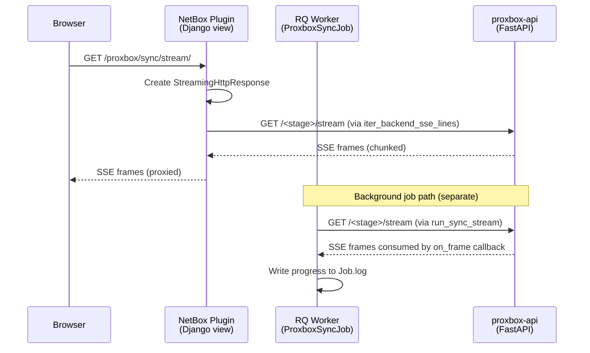
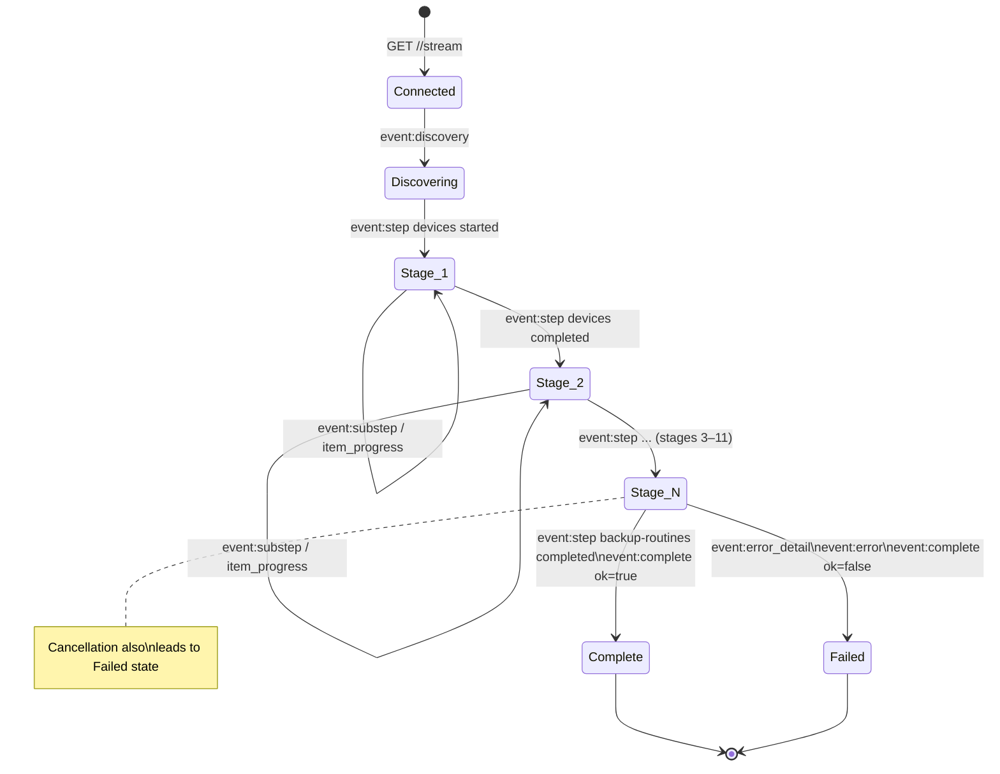

# Streaming Protocol

Proxbox uses **Server-Sent Events (SSE)** as the primary transport for real-time sync progress. A secondary **WebSocket** channel carries broadcast messages for dashboard updates. This page documents both protocols in detail.

---

## Two Sync Transport Modes

=== "SSE Streaming (primary)"
    The plugin opens long-lived HTTP GET calls to backend stage paths such as `proxbox-api/dcim/devices/create/stream` or `proxbox-api/proxmox/sdn/create/stream`. The response is `text/event-stream` and carries SSE frames for each stage and object processed. Scheduled jobs call one backend `/stream` path per selected stage; browser proxy views may still stream a single backend path directly.

    - **Used by**: `ProxboxSyncJob.run()` via `run_sync_stream()`, browser-facing `StreamingHttpResponse` proxy views
    - **Advantages**: real-time per-object progress, no polling needed, works through proxies with `X-Accel-Buffering: no`
    - **Timeout**: HTTP between-chunk read timeout is **3600 s** (`_SYNC_STREAM_READ_TIMEOUT`). The UI-backed RQ job wall-clock limit defaults to **7200 s**.

=== "JSON Polling (legacy)"
    The plugin sends a GET to `proxbox-api/full-update` and waits for a single JSON response containing all sync results.

    - **Used by**: `sync_full_update_resource()`, some older dashboard views
    - **Advantages**: simple request/response, easy to debug
    - **Disadvantages**: no real-time progress, times out on large clusters

---

## SSE Event Types

Every SSE event has the form:

```
event: <event_type>
data: <json_payload>

```

(Note the blank line between events — this is the SSE message boundary.)

### `discovery`

Emitted once at the start of a scheduled full-update job or legacy full-update stream. Lists all stages that will be processed.

```json
{
  "event": "discovery",
  "phase": "full-update",
  "status": "discovered",
  "message": "Discovered 13 sync stage(s) for full update",
  "count": 13,
  "items": [
    {"name": "devices", "type": "stage"},
    {"name": "storage", "type": "stage"},
    ...
  ],
  "progress": {"current": 0, "total": 13, "percent": 0},
  "metadata": {"operation_id": "550e8400-e29b-41d4-a716-446655440000"}
}
```

### `step`

Emitted twice per stage: once when the stage starts, once when it finishes.

```json
// Stage started
{"step": "virtual-machines", "status": "started", "message": "Starting virtual machines synchronization."}

// Stage completed
{"step": "virtual-machines", "status": "completed", "message": "Virtual machines synchronization finished.", "result": {"count": 47}}
```

### `substep`

Emitted by individual sync services for sub-stage progress (e.g., per-VM progress within the VM stage).

```json
{"substep": "vm_create", "status": "processing", "message": "Creating VM web-server-01", "vmid": 100}
```

### `item_progress`

Carries per-object sync result for fine-grained frontend progress bars.

```json
{"event": "item_progress", "name": "web-server-01", "status": "created", "type": "virtual_machine", "id": 42}
```

### `phase_summary`

Emitted by some stages to summarize a batch of objects processed.

```json
{"event": "phase_summary", "phase": "backups", "created": 12, "updated": 3, "skipped": 0, "errors": 0}
```

### `error_detail`

Structured error event with category, suggestion, and detail text.

```json
{
  "event": "error_detail",
  "phase": "virtual-machines",
  "category": "internal",
  "message": "Virtual machine sync failed",
  "detail": "Connection refused to Proxmox VE",
  "suggestion": "Check Proxmox endpoint connectivity and retry"
}
```

### `error`

Short-form error event used alongside `error_detail`.

```json
{"step": "full-update", "status": "failed", "error": "Error while syncing virtual machines.", "detail": "..."}
```

### `complete`

Always the last event in a stream. `ok: true` on success, `ok: false` on failure.

```json
// Success
{"ok": true, "message": "Full update sync completed.", "result": {"devices_count": 3, "virtual_machines_count": 47, ...}}

// Failure
{"ok": false, "message": "Error while syncing virtual machines.", "errors": [{"detail": "..."}]}
```

---

## SSE Proxy Chain

The SSE stream passes through two hops before reaching the browser:



The `iter_backend_sse_lines()` function in `netbox_proxbox/services/backend_proxy.py` opens a streaming `requests.get()` with `stream=True` and yields each raw SSE line. The Django view wraps this in a `StreamingHttpResponse` with `Content-Type: text/event-stream`.

For background jobs, `run_sync_stream()` consumes the SSE stream to completion
using an `on_frame` callback that writes progress data to the NetBox Job record.
It checks readiness against each unique configured candidate in order (primary
URL, then the endpoint's IP fallback). Candidate fallback ends before the
mutating stream request is issued. Once the first ready candidate is selected,
the plugin makes exactly one stream request: connection, TLS, timeout, HTTP,
body, and semantic failures are terminal because proxbox-api may have accepted
or started work even when the plugin has not received a valid SSE frame. A
bounded 401 authentication rebind is the only restart; authentication rejection
occurs before route work, and the retry uses one freshly resolved endpoint
context. Every candidate retains the same authentication, query parameters,
TLS policy, connect/read timeouts, redirect refusal, and callback.

### Background job observer lifetime

`JobStreamSSEView` observes the persisted NetBox Job row for browser job-detail
pages. It sends an SSE comment heartbeat at least every 15 seconds while no job
event is available and sets `X-Accel-Buffering: no`, ensuring Nginx flushes the
comment to the client. A disconnected browser therefore causes the WSGI write
to fail promptly instead of leaving a Gunicorn request thread blocked on an
empty queue. Closing the response also signals the polling producer through a
`threading.Event`; its poll waits are interruptible and the producer exits
without emitting a synthetic terminal event. The producer also brackets its
work with Django's `close_old_connections()` because it is a manually created
thread, and a warning is logged if it survives the bounded shutdown join.

This behavior is an availability invariant. Removing the heartbeat, enabling
proxy buffering, or restoring an unbounded `queue.get()` can strand one gthread
per disconnected browser and eventually make unrelated NetBox API requests
time out. During incident diagnosis, a growing set of `CLOSE-WAIT` sockets on
the NetBox WSGI port together with stacks in `_stream_job_events()` indicates
that this invariant has regressed.

---

## WebSocketSSEBridge

`proxbox-api` uses an internal bridge class to decouple async sync work from SSE frame emission:

```python title="proxbox_api/utils/streaming.py (simplified)"
class WebSocketSSEBridge:
    """Connects an async sync function to SSE frame output."""

    async def send(self, event: str, data: dict) -> None:
        """Called by sync service to emit a progress event."""
        await self._queue.put(sse_event(event, data))

    async def close(self) -> None:
        """Signal that no more events will be sent."""
        await self._queue.put(None)

    async def iter_sse(self) -> AsyncIterator[str]:
        """Yields SSE frames for the HTTP response generator."""
        while True:
            frame = await self._queue.get()
            if frame is None:
                break
            yield frame
```

Each stage gets its own bridge instance. The `full_update.py` event generator runs the sync function as a background `asyncio.Task`, iterates the bridge's SSE output, then awaits the task result:

```python
async def _run_vms_sync():
    try:
        return await create_virtual_machines(..., websocket=vm_bridge, use_websocket=True)
    finally:
        await vm_bridge.close()          # always signal completion

vms_task = asyncio.create_task(_run_vms_sync())
async for frame in vm_bridge.iter_sse():
    yield frame                          # proxy to HTTP response
sync_vms = await vms_task                # collect result
```

---

## Stream Lifecycle State Machine



---

## WebSocket Channel

In addition to SSE, the plugin supports a **WebSocket channel** for broadcast messages. This is used by the `home.js` dashboard to receive sync-end notifications without polling.

```
Browser ──── ws://netbox-host/plugins/proxbox/ws/ ──── websocket_client.py ──── proxbox-api WS
```

The server-side bridge discovers the backend's short-lived metadata/health
capabilities for each authenticated WebSocket connection. It invalidates
positive capability state whenever that connection opens or closes and forces
a fresh capability read when dispatching each correlated command. The bridge
rechecks the connection generation after each unlocked probe, and an envelope
rejection recorded while a probe is in flight overrides that probe's result.
After discovery, and again before any rejection retry, the bridge reloads the
endpoint and requires the exact enablement, credential, and target identity
that opened the WebSocket. Trust loss closes the connection without sending or
downgrading the command, releases its latch, and emits a secret-free failed
`sync-run` record for the poller.
When the current connection advertises `{"capabilities": {"ws_run_id": 1}}`,
the bridge generates a 32-character run identifier and sends this JSON text
frame:

```json
{"command": "Full Update", "run_id": "9e5cf5e2f03a47dbb68b9889719d88b8"}
```

Every response frame for that command must echo the exact `run_id`. The plugin
and `polling.js` ignore missing or different identifiers for completion and
button release. A correlated full update completes only on its aggregate
terminal, including when a stage was skipped:

```json
{
  "object": "full-update",
  "end": true,
  "run_id": "9e5cf5e2f03a47dbb68b9889719d88b8",
  "status": "completed",
  "stages": {"devices": "completed", "virtual-machines": "skipped"}
}
```

An aggregate `status` of `failed` is rendered as an error. Capability discovery
is fail-safe: an absent, malformed, expired, or unreachable capability response
causes the bridge to send the legacy bare command string. Legacy responses have
no run identifier or aggregate terminal, and a full update therefore retains
the existing virtual-machine-terminal completion and idle-latch behavior.
Legacy polling ignores every frame that contains a `run_id`, including a frame
broadcast for another worker's correlated run.

If a queued correlated command reaches a changed connection that no longer
advertises support, the bridge converts that command to the legacy form before
transmission and emits a run-matched `sync-run` control record so its browser
poller also switches to legacy matching. If a backend advertises support but
answers the envelope with an attributable invalid-command response, the bridge
marks support negative for that connection, emits the same control record, and
retries the command once as a bare string. Attribution requires either the
exact matching run identifier or the old backend's exact untagged plain-text
response before any matching run frame has arrived. Foreign, malformed, and
late rejection frames never replay a command. The relay retires an unanswered
pending envelope when its latch expires or a successor replaces it, without
replaying the retired command, so the successor can dispatch on the existing
connection. It never allows the expired run's later terminal to release that
successor.

Capability discovery uses an HTTP request and therefore can reach a different
backend instance from the persistent WebSocket during a rolling deployment. A
capable HTTP peer may cause one envelope attempt against an older WebSocket
peer. The older peer's attributable plain-text invalid-command response marks
that connection legacy and replays the command exactly once as a bare string;
later commands on the same connection remain legacy. The rejected envelope is
not treated as an executed sync. A backend greeting is not required by this
compatibility behavior.

The `websocket.js` script exposes:

```js
onSyncEnd(listener)    // register a callback for sync completion events
notifySyncEnd(obj)     // trigger all registered listeners (called by sync.js)
```

---

## Timeout Architecture

Proxbox involves three distinct timeout layers that must all be longer than the expected sync duration:

| Timeout | Value | Location | Controls |
|---|---|---|---|
| RQ job wall-clock | **7200 s default** | `ProxboxPluginSettings.sync_job_timeout` | Max time for an RQ worker to hold a newly enqueued job before killing it; UI range 3600–604800 s |
| HTTP read (between chunks) | **3600 s** | `_SYNC_STREAM_READ_TIMEOUT` in `backend_proxy.py` | Max time to wait for the next SSE chunk from proxbox-api |
| NetBox API request | **120 s** | `PROXBOX_NETBOX_TIMEOUT` env var | Per-request timeout for netbox-sdk calls inside proxbox-api |

!!! warning "Stuck jobs"
    - **`pending` forever**: no RQ worker is running, or the worker does not listen to the `default` queue.
    - **`running` for a long time**: proxbox-api is still processing — check the Job log for SSE progress events.
    - **`errored` with `JobTimeoutException`**: the RQ wall-clock limit was hit — increase **Synchronization job timeout (seconds)** in Proxbox Settings and enqueue a new job.

    See [Backend Integration](backend-integration.md) for diagnosis steps.
